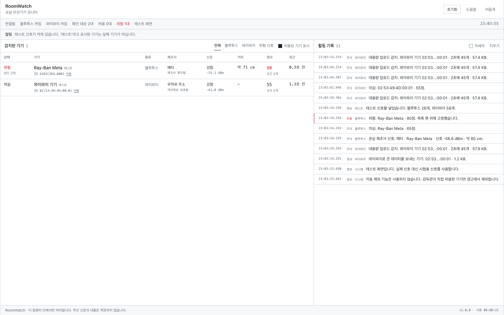

# RoomWatch

**교실 무선기기 모니터.** 시험장 주변의 블루투스와 와이파이 신호를 이 컴퓨터에서만 듣고, 허용되지 않은 기기를 확인 순서대로 보여주는 로컬 도구입니다.

- 클라우드 없음
- 계정 없음
- 패킷 내용 저장 없음
- Wi-Fi 모니터 모드 동안에는 해당 인터페이스의 인터넷 연결이 끊길 수 있음



*테스트 신호를 넣은 화면입니다. 실제 시험장에서는 감지된 기기와 위험도가 표시됩니다.*

도움말 화면은 [docs/help.png](docs/help.png)에서 볼 수 있습니다.

---

## 무엇이 다른가

시험장에서는 모든 전자기기가 금지되는 경우가 많습니다. 그래서 **처음 30초 동안 있던 기기를 자동으로 안전하다고 간주하는 학습 기능을 넣지 않았습니다.** 그런 자동 제외는 학생이 이미 가져온 기기를 놓칠 수 있습니다.

대신 이렇게 동작합니다.

1. 잡히는 기기는 모두 **확인 대상**으로 표시합니다.
2. 공유기, 감독관 노트북처럼 꼭 필요한 기기만 목록에서 **허용**합니다.
3. 허용되지 않은 기기는 위험 점수 순으로 정렬합니다.
4. Wi-Fi 대용량 업로드, 관심 제조사, 근접 신호, 지속 시간을 함께 봅니다.
5. 최종 판단은 담당자가 기기 외관과 소지 여부를 직접 확인합니다.

> RF 신호만으로 스마트 안경과 일반 휴대폰을 100% 구분할 수는 없습니다. 이 도구는 사람이 확인할 후보와 순서를 제공합니다.

---

## 지원 플랫폼

| 기능 | macOS | Linux | Windows |
|---|---|---|---|
| 블루투스 스캔 | CoreBluetooth / bleak | BlueZ / bleak | WinRT / bleak |
| Wi-Fi 모니터 캡처 | `tcpdump -I` | `iw` + `tcpdump` | Npcap + Wireshark `tshark`/`dumpcap` |
| 관리자 권한 | `sudo` | `sudo` | 관리자 PowerShell |
| 실패 시 폴백 | BLE 전용 / 테스트 화면 | BLE 전용 / 테스트 화면 | BLE 전용 / 테스트 화면 |

Wi-Fi 모니터 모드는 **어댑터와 드라이버가 지원해야** 합니다. 내장 Wi-Fi가 거부하면 USB Wi-Fi 어댑터를 사용하세요.

---

## 빠른 시작

### macOS

```bash
cd roomwatch
python3 -m venv .venv
source .venv/bin/activate
python -m pip install --upgrade pip
python -m pip install -r requirements.txt

# BLE만 사용
./.venv/bin/python main.py

# BLE + Wi-Fi 모니터
sudo .venv/bin/python main.py
```

1. 처음 BLE를 켤 때 macOS가 Bluetooth 권한을 요청합니다.
2. **시스템 설정 → 개인정보 보호 및 보안 → Bluetooth**에서 실제로 앱을 실행한 터미널(Terminal, iTerm2, VS Code)을 허용합니다.
3. 권한 변경 후 터미널을 완전히 종료하고 다시 엽니다.
4. `sudo` 실행은 가상환경 안의 Python을 직접 지정해야 합니다. `sudo python`은 시스템 Python을 사용할 수 있습니다.

Wi-Fi 모니터 모드 중에는 `en0`의 인터넷 연결이 끊깁니다. 대시보드는 같은 Mac의 `http://127.0.0.1:8000`에서 계속 열립니다.

### Linux

필요 패키지 예시(Debian/Ubuntu):

```bash
sudo apt update
sudo apt install -y python3-venv python3-pip tcpdump iw bluez
sudo usermod -aG bluetooth "$USER"
# 그룹 변경 후 로그아웃/로그인

cd roomwatch
python3 -m venv .venv
source .venv/bin/activate
python -m pip install --upgrade pip
python -m pip install -r requirements.txt

# BLE만 사용
./.venv/bin/python main.py

# BLE + Wi-Fi 모니터
sudo .venv/bin/python main.py
```

- Wi-Fi 캡처는 `iw dev <iface> set type monitor`로 인터페이스를 전환한 뒤 `tcpdump`로 radiotap pcap을 읽습니다.
- NetworkManager가 인터페이스를 계속 관리하면 모니터 모드가 실패할 수 있습니다. 필요하면 해당 인터페이스를 잠시 관리 대상에서 제외하세요.
- 프로그램 종료 시 `managed` 모드로 복구를 시도하지만, 배포판에 따라 수동 재연결이 필요할 수 있습니다.

### Windows

1. [Wireshark](https://www.wireshark.org/)를 설치하면서 **Npcap**을 함께 설치합니다.
2. Npcap 설치 옵션에서 **Support raw 802.11 traffic (and monitor mode)**를 켭니다.
3. `tshark.exe`가 PATH에 있거나 `C:\Program Files\Wireshark\`에 있어야 합니다.
4. Bluetooth를 켭니다.
5. PowerShell:

```powershell
py -3.12 -m venv .venv
.\.venv\Scripts\python.exe -m pip install --upgrade pip
.\.venv\Scripts\python.exe -m pip install -r requirements.txt

# BLE만 사용
.\.venv\Scripts\python.exe main.py

# Wi-Fi 모니터: 관리자 권한 PowerShell
Start-Process powershell -Verb RunAs
cd C:\path\to\roomwatch
.\.venv\Scripts\python.exe main.py
```

- 자동 인터페이스 선택이 실패하면 관리자 PowerShell에서 `tshark -D`를 실행해 Wi-Fi 인터페이스 번호를 확인하고 `--iface 1`처럼 지정합니다.
- Windows 내장 Wi-Fi 어댑터는 모니터 모드를 지원하지 않는 경우가 많습니다. 이때는 BLE 전용으로 동작하거나, 모니터 모드를 지원하는 USB 어댑터를 사용해야 합니다.
- Wi-Fi 모니터 모드 중에는 인터넷이 끊길 수 있습니다. 대시보드는 `127.0.0.1`에서 계속 열립니다.

---

## 대시보드 읽기

| 표시 | 의미 |
|---|---|
| **위험** | 75점 이상. 목록 맨 위에 고정됩니다. |
| **의심** | 45~74점. |
| **관찰** | 20~44점. |
| **확인 필요** | 20점 미만. 그래도 전자기기 금지 시험에서는 확인 대상입니다. |
| **허용됨** | 감독관이 직접 경고에서 제외한 기기. |

점수는 다음을 더한 값입니다.

| 근거 | 점수 |
|---|---:|
| BLE 관심 제조사 ID | +45 |
| BLE 근접 신호 (`RSSI_filtered >= -78 dBm`) | +20 |
| Wi-Fi 업로드 버스트 | +40 |
| 10초 이상 지속 | +15 |

화면의 **허용**은 신중하게 사용하세요. 허용한 기기는 경고에서 빠집니다. **허용 취소**로 되돌릴 수 있고, **초기화**는 허용 목록까지 모두 지웁니다.

테스트 신호는 **도움말** 창 아래에 있습니다. 실제 스마트 안경 없이 화면과 판정을 확인할 때만 사용하세요. 테스트 기기는 `테스트`로 표시됩니다.

---

## 판정 모델

### BLE

```text
RSSI_filtered = 0.3 × current + 0.7 × previous
distance = 10 ^ ((P_tx - RSSI_filtered) / (10 × 2.5))
```

- `P_tx` 기본값은 `-59 dBm`입니다.
- 광고된 TX Power가 1m 기준 RSSI로 현실적인 `-100 ~ -25 dBm` 범위일 때만 사용합니다.
- `RSSI_filtered <= -86 dBm`은 교실 밖 신호로 보고 버립니다.
- macOS는 BLE MAC 대신 임시 UUID를 줍니다. Windows/Linux에서는 MAC이 보일 수 있습니다.

### Wi-Fi

아래 조건을 모두 만족하는 프레임만 `addr2`별 2초 큐에 넣습니다.

```text
type == 2
ToDS == 1 and FromDS == 0
frame_len >= 1100 bytes
dBm_AntSignal >= -78 dBm
```

2초 안에 45개 이상이면 `UPLOAD_BURST`로 기록합니다. 802.11 AP의 하향 트래픽은 이 조건에 들어오지 않으므로, 주로 단말의 업로드 방향을 보게 됩니다.

### 하지 않는 것

- 패킷 내용 복호화
- WPA 키 추출
- 기기 연결 차단
- 클라우드 전송
- 자동 화이트리스트 학습

---

## 구성

```text
roomwatch/
├── main.py
├── config.py
├── detector.py
├── scanner_ble.py
├── scanner_wifi.py
├── simulator.py
├── requirements.txt
├── README.md
├── LICENSE
├── docs/
│   ├── screenshot.png
│   └── help.png
└── static/
    └── index.html
```

- `scanner_wifi.py`는 macOS/Linux/Windows별 캡처 계획을 만들고, 동일한 pcap 파서로 전달합니다.
- `detector.py`는 모든 플랫폼에서 같은 점수와 상태를 계산합니다.
- `static/index.html`은 빌드 없는 단일 대시보드입니다.

---

## 옵션

```bash
./.venv/bin/python main.py --help
```

| 옵션 | 기본값 | 설명 |
|---|---|---|
| `--host` | `127.0.0.1` | 바인드 주소 |
| `--port` | `8000` | HTTP/WebSocket 포트 |
| `--iface` | `auto` | Wi-Fi 인터페이스. macOS `en0`, Linux `wlan0`, Windows `tshark -D` 번호 |
| `--simulate` | off | 실제 스캐너 없이 테스트 화면 실행 |
| `--no-ble` | off | BLE 비활성화 |
| `--no-wifi` | off | Wi-Fi 비활성화 |
| `--sim-interval` | `30` | 테스트 신호 반복 주기(초) |

---

## API

| Method | Path | 설명 |
|---|---|---|
| GET | `/` | 대시보드 |
| GET | `/api/state` | 전체 스냅샷 |
| GET | `/api/health` | 상태 확인 |
| POST | `/api/devices/allow` | 기기 허용/취소. `{"key":"ble:...","allowed":true}` |
| POST | `/api/simulate` | 테스트 신호 주입 |
| POST | `/api/reset` | 감지 결과와 허용 목록 초기화 |
| WS | `/ws` | 상태/이벤트 실시간 스트림 |

---

## Wi-Fi가 0프레임일 때

`와이파이 감지 중 · 신호 없음`은 캡처 도구는 떴지만 802.11 프레임이 없다는 뜻입니다.

### macOS

```bash
# 현재 서버 종료
kill $(pgrep -f "main.py --port 8000")

cd roomwatch
sudo .venv/bin/python main.py
```

- 관리자 권한 없이 실행하면 모니터 모드가 실제로 켜지지 않을 수 있습니다.
- `en0`가 모니터 모드로 바뀌면 인터넷이 끊깁니다.
- 내장 Wi-Fi가 거부하면 USB Wi-Fi 어댑터를 사용하세요.

확인:

```bash
sudo tcpdump -L -I -i en0
```

`IEEE802_11_RADIO`가 보여야 합니다.

### Linux

```bash
sudo iw dev
sudo ip link
sudo tcpdump -i wlan0 -y IEEE802_11_RADIO -c 5
```

- `iw`와 `tcpdump`가 설치되어 있어야 합니다.
- NetworkManager가 인터페이스를 잡고 있으면 모니터 모드 전환이 실패할 수 있습니다.
- `rfkill list`로 Wi-Fi가 차단되지 않았는지 확인하세요.

### Windows

```powershell
tshark -D
tshark -i 1 -I -c 5
```

- Npcap의 802.11 모니터 모드 옵션이 필요합니다.
- 관리자 권한이 필요할 수 있습니다.
- 어댑터가 모니터 모드를 지원해야 합니다. 내장 어댑터는 대개 제한적입니다.

---

## 보안과 개인정보

- 수동 캡처만 합니다. 패킷을 재전송하거나 연결을 끊지 않습니다.
- 패킷 내용은 저장하지 않습니다. 기기 이름, 제조사, 신호 세기, MAC/UUID 같은 겉정보만 메모리에 둡니다.
- 허용 목록도 메모리에만 있고, **초기화**하면 함께 사라집니다.
- 기본 바인드는 `127.0.0.1`이며 인증이 없습니다. `--host 0.0.0.0`으로 열면 같은 네트워크의 누구나 접근할 수 있으므로 신뢰된 망에서만 사용하세요.
- 실제 시험장에서는 관리자/기관의 승인과 관련 법규를 확인한 뒤 사용하세요. 이 도구는 징계나 법적 판단의 단독 증거가 아닙니다.

---

## 개발

```bash
python3 -m venv .venv
source .venv/bin/activate
python -m pip install -r requirements.txt
python -m compileall -q .
./.venv/bin/python main.py --simulate
```

- Python 3.11+
- FastAPI, uvicorn, bleak, scapy
- 프론트엔드 빌드 없음

---

## License

MIT. [LICENSE](LICENSE)를 참고하세요.
